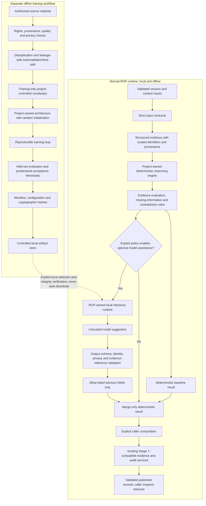

# Stage 8: First-Party Native Intelligence Architecture

**Status:** Proposed architecture for review; documentation only  
**Applies to:** Stage 8 planning, Tasks 201–215  
**Baseline:** Stage 7 integration through Task 200 is on main, together with the Stage 7 post-validation fixes merged through PR #15 that corrected the Task 200 checkpoint's two integration-test failures and Black failure. The project owner reports that the final local pytest, Ruff, and Black gates passed on that remediated Stage 7 tree. This document does not independently reproduce that run and does not claim any Stage 8 capability has been implemented.

## 1. Architectural decision

ROP will develop and own its reasoning algorithms and, if the measured use case justifies it, a model whose weights are initialized randomly and trained by this project on authorized data. Normal reasoning must remain useful and testable without a trained model. A model is an optional, bounded component; it is not the source of truth for identity, provenance, evidence, status, release readiness, or clinical decisions.

The intended system is local-first and offline-capable. It must not depend on another company's model, a hosted inference service, an external model-serving product, downloaded pretrained weights, or a third-party pretrained tokenizer artifact. A general-purpose numerical or training library may supply tensor operations and optimizers, but using it does not authorize use of its model hub, pretrained checkpoints, hosted services, or automatic download features.

This specification establishes boundaries and acceptance rules. It does not authorize source modules, dependencies, training scripts, data acquisition, model weights, or production changes for the architecture work it describes. The separately reviewed Stage 7 validation and schema-layering remediation merged through PR #15 was part of the wider Task 201 history, not a change authorized by this document.

## 2. Goals and non-goals

### 2.1 Goals

- Keep the existing deterministic ROP infrastructure as a usable baseline with independent tests and explicit contracts.
- Develop a project-owned deterministic reasoning engine that composes auditable algorithms without hidden provider discovery, implicit fallback, or global mutable registries.
- Represent evidence and uncertainty explicitly, preserve the source of every supported assertion, identify readable contradictions, and abstain when conclusions are not justified.
- Establish a controlled data pipeline and reproducible vocabulary/model/training artifacts before relying on learned behavior.
- If a neural model proves useful on a defined narrow task, run the project's own randomly initialized and trained artifact locally through a strict, validated interface.
- Preserve the meaning of Stage 7 evidence, audit, consistency, identity, fingerprint, and handoff contracts.
- Evaluate the neural component against the deterministic baseline on a held-out dataset with metrics and pass thresholds defined before inspecting final test results.

### 2.2 Non-goals

Stage 8 does not promise parity with commercial language models, open-ended general intelligence, autonomous clinical decisions, or improved accuracy merely because a neural model exists. It does not introduce online learning, training during API requests, automatic model downloads, automatic external-provider fallback, hidden network inference, or a release path that bypasses existing audits.

The first learned capability should be narrow enough to evaluate with a clear label space and reproducible benchmark, such as a constrained classification or evidence-tag suggestion task. A model-generated suggestion is not evidence that the suggested claim is true. It must never manufacture a source record, evidence identifier, session identity, audit verdict, or certification.

### 2.3 Keep the system useful without training

The deterministic engine must be buildable, testable, and usable while no model artifact exists. Missing, corrupt, incompatible, or unapproved model artifacts must produce an explicit unavailable/disabled optional-assistance result, not disable the deterministic path. Tests for deterministic rules must not require a trained model, training data, GPU, or model artifact.

## 3. Distinguish the system layers

1. **Existing deterministic ROP infrastructure.** Current production code contains deterministic session/context handling, rule-based recognition and missing-information logic, and reasoning/evidence/certification boundaries. The current behavior and its tests remain the baseline; this task does not rewrite it.
2. **First-party deterministic reasoning engine (to be developed).** A project-owned orchestration and algorithm layer for structured inputs, evidence evaluation, candidate comparison, conflict reporting, and explicit abstention. It must have explicit dependencies and no implicit provider selection.
3. **ROP-trained neural model (future, conditional).** A model architecture and weights selected for a measured task, with parameters initialized from a documented random seed and trained by the project from authorized training data. There is no such Stage 8 model implementation claimed by this specification.
4. **Training and evaluation infrastructure (future).** An offline pipeline for authorized data, deterministic preprocessing, dataset splits, training, held-out evaluation, artifact manifests, and integrity checks. It is not part of normal application request processing.
5. **Local inference runtime (future).** A local execution boundary that loads a specifically selected, integrity-checked ROP-trained artifact. It must work on CPU where practical and may offer explicitly optional GPU acceleration.
6. **Stage 7 evidence, audit, consistency, and handoff chain.** Existing services consume and validate published records when called by their caller. They do not automatically orchestrate predecessor/successor services, select a model, authorize inference, or execute a release. Stage 8 must preserve their contracts and truthful statuses.

## 4. Proposed component boundaries and contracts

These are responsibilities and design contracts, not a request to create empty packages or placeholder modules. Later tasks must inspect the current implementation before choosing exact file names or changing public schemas.

### 4.1 Native reasoning engine

**Responsibility:** Compose project-owned deterministic algorithms over validated input records. Produce explicit result records, reason codes, evidence links, uncertainty, and missing-information requests.

**Input:** Strictly validated session/context identity and structured evidence records. Dependencies are supplied explicitly at construction or call time.

**Output:** A strict project-owned result contract. The output must distinguish a result derived from deterministic rules from an optional model suggestion.

**Rules:** No hidden model/provider selection, global mutable registries, implicit network access, persistence, or training. The engine must be independently testable with fixed inputs and injected collaborators. Errors are explicit and deterministic; missing inputs are not repaired by fabricating data.

### 4.2 Structured evidence representation

Each evidence item should carry only contract-approved fields, with stable identifiers and validated references. The intended concepts are: evidence identifier, session/case binding, normalized assertion or observation, evidence type/stance, source reference, source provenance, status/availability, and relevant uncertainty metadata.

The representation must distinguish source facts from derived interpretations and model-generated suggestions. A suggestion cannot be re-labelled as an observed fact. Do not include raw provider objects, arbitrary runtime objects, credentials, private filesystem paths, or unrestricted request/response payloads in published evidence records.

References must resolve to records in the trusted input set. Preserve identifiers and provenance verbatim rather than recomputing or inventing them. A malformed or detached evidence reference fails closed under the responsible contract.

### 4.3 Evidence evaluation, contradictions, missing information, and abstention

The deterministic evaluator compares only supported evidence relations defined by project rules. It must keep these cases distinct:

- **Supported:** the conclusion is backed by explicit validated evidence references.
- **Contradicted:** readable evidence supports mutually incompatible claims, or a published record conflicts with an independently derived expectation.
- **Insufficient / unavailable:** necessary evidence is missing, unreadable, or not bound to the requested case.
- **Unknown / not assessed:** the system has no justified basis for a conclusion.

A readable contradiction must not be collapsed into a generic malformed/unavailable outcome. Conversely, missing data alone must not be invented into a contradiction. Uncertainty, missing fields, rule identifiers, and the exact evidence references used should be inspectable. A model may propose candidate labels or missing-information suggestions, but the deterministic evaluator and strict output validator decide whether those suggestions are admissible as suggestions. Neither a model nor a successful audit may promote an unsupported conclusion.

### 4.4 Training-data pipeline

Training data enters through an explicit offline command/workflow, never through an API request. The pipeline must:

1. Verify authorization, license/consent, intended purpose, source provenance, and permitted retention before reading records into a dataset.
2. Reject records with unknown rights, unverifiable origins, prohibited sensitive content, corrupt structure, or unsupported labels.
3. Normalize and validate records using a versioned, deterministic transformation; report rejected-record counts and reason codes without echoing sensitive content.
4. Deduplicate exact and near-duplicate records before splitting. Group by patient/source/original document or another leakage-relevant unit so related records cannot cross train/validation/test partitions.
5. Create versioned, reproducible manifests with safe source identifiers, split assignments, transformation versions, record counts, label distributions, and content hashes where privacy permits. A manifest must not contain raw patient details or reversible identifiers unnecessarily.
6. Keep training, validation, and test partitions separate. Fit data-dependent vocabulary/statistics on training data only. The final test set is held back until evaluation.
7. Provide a reproducible build command and explain how data may be lawfully obtained and securely stored outside ordinary Git history.

If the pipeline cannot establish rights, provenance, or permitted purpose, reject the record rather than guessing. An approved data source can still contain unusable records.

### 4.5 Tokenizer and vocabulary

Use a project-controlled and documented vocabulary-building process. The first version should define Unicode normalization, case handling, token boundaries, reserved symbols, out-of-vocabulary behavior, deterministic frequency ordering, tie-breaking, and vocabulary version identifiers.

Build data-dependent vocabulary from the authorized training partition only, not from held-out validation/test text. Do not download or embed a pretrained tokenizer vocabulary or vocabulary merges. Persist the exact tokenizer configuration and vocabulary hash with the model artifact. Tokenization must be tested for deterministic behavior, malformed Unicode/input handling, safe truncation, and preservation of boundaries required by the target task.

The tokenizer is a versioned part of the model contract: a weight file without its matching vocabulary/configuration is not a valid model artifact.

### 4.6 Initial native model architecture

The first candidate should be a compact encoder-style Transformer for a bounded classification/tagging or evidence-suggestion task, with project-owned token embeddings, positional representation, attention/feed-forward blocks, and a project-owned output head. All trainable parameters must be randomly initialized under a recorded seed; no downloaded weights, pretrained backbone, pretrained embedding table, adapter-on-pretrained-base, or renamed third-party model is allowed.

This is an initial candidate, not a claim that a Transformer is necessarily the best or smallest answer. Before fixing layer count, width, vocabulary size, sequence length, parameter count, or precision, measure the target task and memory/runtime constraints on representative authorized data. Record the decision and compare with a simpler baseline. If the first useful task needs a simpler classifier or another compact architecture, document the evidence and revise the choice in its own reviewed task.

The initial model must have a bounded output contract and cannot claim general clinical understanding. Free-form text generation is not a prerequisite for Stage 8 and should not be added without a separate measurable use case and a safe output boundary.

### 4.7 Training loop

The offline training loop must load only the explicitly selected, approved dataset manifest and vocabulary version. It must record configuration, random seeds, library versions, partition hashes, optimizer/scheduler settings, batch size, sequence-length limits, checkpoint cadence, and evaluation metrics.

Use deterministic settings where supported and document any known non-determinism from library kernels or hardware. A fixed seed alone is not proof of full reproducibility. Validation data can be used for model selection and early stopping; test data must not be used to tune training. A resumed run must check that checkpoint configuration, vocabulary, dataset manifest, and code/version identity match the run or fail with a clear compatibility error.

Resource exhaustion, missing data, invalid labels, non-finite loss/weights, interrupted runs, and incompatible resumes must produce informative failures. A failed run must not be marked as an approved artifact.

### 4.8 Model artifact management

Every candidate artifact needs a manifest containing at minimum:

- Architecture and configuration version.
- Model artifact identifier and cryptographic hash.
- Tokenizer/vocabulary version and hash.
- Training-data manifest identifier/hash and split manifest version.
- Source-code revision, dependency/library versions, random seed, and training parameters.
- Training completion/failure state, checkpoint-selection rule, and evaluation report identifier.
- Intended task, known limitations, approval state, and creation metadata.

Do not commit large weight/checkpoint files, raw datasets, credentials, or private clinical information to ordinary Git history. Keep weights in a controlled local/external artifact directory or approved artifact store, with size/content rules and Git ignore coverage. Store safe manifests and reviewable metadata in source control only when they disclose no sensitive information. On load, verify the artifact hash, manifest compatibility, and approval state before inference; never fetch a replacement artifact over the network automatically.

### 4.9 Local inference runtime

The first runtime should execute in-process on CPU where practical. A separate project-controlled local process may be considered only with an explicit contract, bounded permissions, and its own review; local execution must not disguise a remote service.

The runtime receives a typed request and a specific verified local artifact. It performs no training, data download, provider discovery, remote inference, or artifact auto-update. Resource limits cover input length, batch size, time/memory budgets, and concurrency. Missing or invalid artifacts return a typed unavailable result or leave optional assistance disabled while deterministic reasoning continues. Device choice must be explicit and observable; absence of a GPU is not an error for CPU-supported tests.

### 4.10 Output validation and integration boundary

Model output is untrusted input. Before any output is exposed to other ROP components, the adapter must validate:

- Exact output schema, field types, value ranges, allowed labels, and size limits.
- Session/case identity against the current request; no model-generated identity is trusted.
- Every evidence reference against the supplied validated evidence set.
- Provenance and source fields from trusted inputs, not free-form model claims.
- Findings, uncertainty, abstention, and contradiction semantics required by the result contract.
- Privacy restrictions for output values, diagnostics, errors, and logs.

Reject malformed or unsupported outputs; do not heuristically repair them into a passing result. The adapter may retain a model suggestion as a clearly labelled suggestion after validation, but it cannot alter source evidence, deterministic rule results, audit findings, certification, status, fingerprint, or release readiness. Errors must not echo raw provider/model text unnecessarily.

Any future integration with the existing Stage 7 boundary must use explicit injection and honest project-owned model attribution where the existing contract requires attribution. No Task 201 change may bypass Task 158 response validation or fabricate provider/model fields to satisfy schemas.

### 4.11 Evaluation and regression suite

The evaluation suite must exist before the first training result is treated as meaningful. For each narrow capability, define the task, authorized dataset version, baseline, metrics, confidence/uncertainty policy, resource limits, and pass thresholds before evaluating the final held-out test set.

At minimum measure:
- Task-appropriate classification/ranking metrics, confusion matrices, class-level failures, and errors by relevant subgroup where authorized and statistically meaningful.
- Deterministic baseline performance on exactly the same held-out cases.
- Unsupported claims and invalid/made-up evidence references admitted (target: zero).
- Schema rejection behavior, contradiction handling, abstention, missing/unreadable inputs, and detached identity.
- Repeatability under a fixed supported CPU environment and artifact/configuration.
- Resource use: model size, peak memory, inference latency, and failure at configured limits.
- Privacy sentinel leakage, dataset split leakage, license/provenance enforcement, and offline behavior.
- Regression of existing deterministic rules and all Stage 7 contracts.

Do not choose metrics only after seeing the result. Record failures as failures and keep the deterministic baseline as the usable path if the learned model does not meet its predeclared bar.

## 5. Data governance and medical safety

Training or evaluation data may be used only where licensing, permission, consent, and intended use have been established and recorded. Public availability does not automatically authorize training. Data with uncertain rights or undocumented provenance is rejected until resolved.

Patient data and other sensitive information require data minimization, role-restricted storage, appropriate access logging, retention/deletion rules, and approved handling procedures. Do not commit PHI, identifiable examples, secrets, raw training corpora, or reversible identifiers to Git. Dataset manifests and test fixtures should use synthetic or appropriately de-identified examples when possible and must not leak source records through error messages.

Dataset splits must prevent patient/source/document leakage. Keep test labels and records inaccessible to training and tuning code. Version each import, validation, normalization, deduplication, and split procedure. A dataset version is defined by its manifest and transformation lineage, not by an informal folder name.

A clear UI/API distinction must separate trusted input evidence, deterministic conclusions, model-generated suggestions, and unavailable/abstained results. The model must not transform suggestions into facts or silently suppress a contradiction. Any capability intended for clinical settings requires fit-for-purpose validation, an appropriate clinical evaluation plan, and qualified human oversight before real-world use. Passing software tests or an internal benchmark is not clinical validation and does not authorize autonomous clinical decisions.

## 6. Resource-aware strategy

Start with a narrow task and a small pilot dataset. Measure rather than assume the best architecture, training duration, quality, memory budget, or hardware needs.

- Keep deterministic CPU tests as the mandatory baseline; no GPU is required to run the core suite.
- Make GPU acceleration optional and explicitly selected. CPU and GPU outputs should satisfy the same contracts; document any numerical tolerance and reproducibility differences.
- Enforce configurable limits on sequence length, batch size, workers, artifact size, memory, and runtime. Fail with actionable errors instead of exhausting the host silently.
- Run small overfit/sanity experiments first to test data flow, gradients, checkpoint/resume, and evaluation logic. A tiny-model training run proves plumbing only, not useful capability.
- Record benchmark hardware/software, peak resident memory, artifact size, training samples/steps, latency, and metrics.
- Compare the learned model against a deterministic baseline. Keep the model optional or reject it if it does not add measurable value.

No fixed training time, model performance, dataset size, or hardware budget is promised before the relevant experiment exists.

## 7. Offline operation and first-party enforcement

The following restrictions are mandatory for the application and model path:

1. No OpenAI, Anthropic, Gemini, or any other company's pretrained/runtime model as a ROP reasoning dependency.
2. No Ollama or other external model-serving runtime.
3. No hosted inference API, remote model endpoint, or network inference.
4. No downloaded or embedded third-party pretrained weights, checkpoints, proprietary model artifacts, or pretrained tokenizer assets.
5. No fine-tuning, wrapping, adapters on, or renaming a third-party pretrained model to claim ROP ownership.
6. No automatic model/dependency/data downloads during startup or inference.
7. No credentials or private/unauthorized datasets in Git; no large weights in normal repository history.
8. No implicit provider discovery, hidden fallback, or environment-controlled selection of a remote provider.
9. No model output bypass of evidence provenance, schema validation, privacy rules, uncertainty, contradiction handling, audit, or downstream consistency checks.
10. No weakening or disabling of Stage 7 safeguards merely to make a future model work.

General-purpose numeric/training libraries may be evaluated as tools. Their tensor operators, optimizers, autodifferentiation, and local storage primitives may be used where justified. Their model hubs, pretrained-model classes/checkpoints, auto-downloading convenience APIs, telemetry/network facilities that violate offline operation, and hosted services are prohibited. Dependency review must evaluate licenses, transitive packages, and network/download behavior.

### 7.1 Explicit dependency injection and offline tests

Native model use must be an explicit local dependency, selected by application composition after policy/configuration validation. The default must not discover, download, or select a model. Unit tests should inject a small deterministic test double at the boundary; production must load only an approved ROP-native artifact. The test double is test infrastructure, not a model implementation.

Offline regression tests must fail if an unexpected network request, remote model client, provider fallback, model-hub download, or artifact fetch is attempted. Prefer tests targeted at actual imports/clients and dependency seams rather than broad, fragile monkeypatching of unrelated global infrastructure. A clean offline run must work with no internet connection and no model artifact for deterministic features.

### 7.2 Preserve Task 153 entry checks and Stage 7 contracts

The current Task 153 entry service checks boundary-module presence, schema/outcome consistency, explicit provider injection, and the production tree for known concrete-provider indicators, network-client imports, credential assignment, and environment-driven provider activation. It also delegates to the canonical Stage 6 certification service and does not call a model or open a network connection. These checks are a safety boundary, not an obstacle to bypass.

Task 201 does not change those checks. The initial local runtime should favor in-process execution and explicit injection. If a later task demonstrates that the existing checks cannot distinguish a project-owned local module from a prohibited integration, propose the narrowest documented change in a separate task, backed by tests that continue to reject known third-party providers, network inference, credential literals, automatic selection, and remote fallback. Never disable the scan globally, add false success results, or let a model decide its own eligibility.

Stage 7 remains an externally composed evidence/audit/consistency chain. Callers pass validated results between services according to the existing contracts. A new model must not be inserted by pretending Stage 7 automatically orchestrates inference or authorizes a release. Any adapter or schema change needed for truthful ROP-native attribution must be independently reviewed and must preserve source, session, fingerprint, status, finding, and audit semantics.

## 8. Architecture flow

The runtime path and training path are separate. The diagram is a target design, not a representation of code already implemented. The caller explicitly composes services; Stage 7 does not invoke the model.

Training is never triggered by inference, API access, or a user session. The runtime loads only an explicitly selected and verified artifact. An unavailable or rejected model must not prevent the deterministic baseline from functioning.

## 9. Eventual Stage 8 acceptance criteria

Stage 8 must not be declared complete merely because a model trains or the tests pass. The exact thresholds for a learned capability must be approved before final evaluation. At minimum, evidence for completion must demonstrate:

- **Ownership:** model architecture and all loaded trainable weights originate from this project's documented random initialization and approved training run; manifest and hashes verify. No third-party pretrained model, checkpoint, embedding, or tokenizer artifact is loaded.
- **Deterministic baseline:** supported deterministic functionality works and is independently testable with the model disabled or absent.
- **Offline operation:** a clean supported environment can run the accepted local path without network inference, remote endpoint, model-serving dependency, or implicit download; boundary tests fail on attempted prohibited calls.
- **Data lineage:** every accepted dataset record has a documented permitted source/purpose and reproducible processing lineage; unauthorized/unknown-provenance records are rejected. Leakage checks demonstrate no source/patient group overlap across splits.
- **Evidence integrity:** zero unsupported evidence references or fabricated identity/provenance fields are admitted in the regression suite; readable contradictions remain distinguishable; insufficient evidence triggers explicit abstention.
- **Contract enforcement:** all accepted outputs validate against strict schemas; malformed, oversized, detached, private, or contradictory outputs cannot be published as trusted evidence.
- **Reproducibility:** documented seeds, versions, configuration, dataset/vocabulary hashes, checkpoints, and selected artifact can be reproduced under the defined environment, with known hardware/library limitations stated.
- **Measured utility:** a predeclared held-out benchmark reports suitable task-specific metrics against the deterministic baseline, subgroup limits where justified, uncertainty/abstention behavior, latency, memory, and artifact size. The model is not accepted if it fails the predeclared target.
- **Regression and safety:** existing Stage 7 and deterministic tests remain intact and pass the final project gates. Clinical-use claims remain out of scope until separate qualified validation and oversight requirements are met.

## 10. Major risks and closure evidence

| Risk | Mitigation | Evidence required to close |
| --- | --- | --- |
| Insufficient or unrepresentative training data | Start with a narrow target, measure coverage, document class balance and limitations, keep deterministic fallback | Approved dataset manifest, coverage report, held-out evaluation and subgroup analysis where justified |
| Unclear license, consent, or provenance | Reject data until rights and purpose are documented | Source register and audited authorization record per dataset version |
| Sensitive-data leakage | Minimize and de-identify where permitted; restrict storage; never commit raw data; scan output/log paths with sentinels | Privacy review, repository scan, access/retention procedure and passing leakage tests |
| Duplicate/patient/source leakage across splits | Deduplicate before splitting and group related records; keep final test set isolated | Reproducible split manifest and overlap/leakage report |
| Model underperformance or overconfidence | Compare against deterministic baseline, calibrate abstention, predeclare limits, preserve deterministic output | Held-out metrics, error analysis, calibration/abstention report, approved threshold decision |
| False clinical confidence | No autonomous clinical decisions; label suggestions and limitations; require qualified oversight for clinical use | Intended-use statement, safety test report, documented clinical validation and oversight before deployment |
| Irreproducible training or artifact substitution | Record seeds, versions and hashes; verify artifact on load; pin compatible configurations | Repeat-run comparison, manifests, hash verification tests and checkpoint/resume tests |
| Limited RAM/CPU or unavailable GPU | Small pilot, CPU path, bounded inputs/batches and explicit resource budgets | Benchmark report on supported hardware, limit/failure tests and no-GPU test run |
| External service/pretrained artifact accidentally introduced | Dependency/license review, no automatic downloads, offline tests, import/client scanning | Dependency audit, repository/artifact inventory and negative tests proving prohibited paths fail |
| Model output bypasses trust boundaries | Treat output as untrusted; strict schema, identity/provenance and evidence-reference validation | Adversarial output suite showing invalid suggestions cannot enter trusted records |
| Scope expands before evidence | One bounded task per prompt; review each task and allow roadmap changes based on actual evidence | Task-by-task commit review and accepted decision record |

## 11. Provisional roadmap: Tasks 201–215

The task sequence is dependency-aware but provisional. Each task must receive its own prompt, implementation, diff review, and acceptance verdict. Do not implement all of Stage 8 in a single batch. Revise the roadmap if repository inspection, data permissions, benchmarks, or experiments show that a step is premature or technically unsound.

| Task | Proposed scope | Prerequisites | Observable acceptance evidence |
| --- | --- | --- | --- |
| **201** | Define this native-intelligence architecture and update the README. | Current main and Stage 7 contracts reviewed. | Documentation-only architecture diff, explicit prohibitions, linked architecture, reviewed roadmap. The wider Task 201 history also includes the Stage 7 validation and schema-layering remediation merged through PR #15. |
| **202** | Define strict request/result/error contracts for native reasoning and advisory suggestions. | 201 approved. | Strict schema tests for field sets, statuses, uncertainty, abstention and extra-field rejection; no runtime model. |
| **203** | Implement structured evidence/provenance records and validators using existing conventions. | 202 approved. | Tests for canonical identifiers, source binding, invalid references, immutability and fail-closed behavior. |
| **204** | Implement or extend project-owned deterministic reasoning composition. | 202–203 approved. | Deterministic fixtures, explicit dependencies, stable findings and no model/provider dependency. |
| **205** | Implement contradiction, missing-information and abstention semantics for the new engine contracts. | 203–204 approved. | Separate tests for contradiction versus unavailable evidence, plus traceable supporting/contradicting references. |
| **206** | Build a baseline evaluation harness and pre-register task metrics before neural experiments. | 203–205 approved; permitted evaluation data available. | Fixed baseline report format, held-out split policy, metrics/thresholds documented before training. |
| **207** | Implement authorized dataset manifests, validation, deduplication, privacy controls and leakage-safe splits. | 206 scope and source permissions approved. | Reproducible manifests; unauthorized data rejection; train/validation/test overlap checks. |
| **208** | Implement project-controlled tokenizer/vocabulary construction. | 207 approved dataset pipeline. | Deterministic training-only vocabulary, version/hash metadata, malformed-input and split-leakage tests. |
| **209** | Implement the smallest justified randomly initialized native model for the selected narrow task. | 206 benchmark; 208 tokenizer; resource feasibility measured. | Architecture/config docs, random initialization tests, no pretrained artifact path, smoke test under defined resource limits. |
| **210** | Implement reproducible training and validation loop. | 207–209 approved. | Seed/config capture, deterministic settings documented, interrupted/resumed run checks and explicit invalid-run failures. |
| **211** | Implement model artifact manifests, checkpoint integrity and compatibility validation. | 208–210 approved. | Hash checks, metadata compatibility tests, rejected corrupt/incompatible artifacts, weights excluded from ordinary Git history. |
| **212** | Implement the local CPU inference runtime with explicit artifact selection. | 211 approved. | In-process offline inference, no implicit downloads/provider selection, bounded resource/error behavior, no-GPU tests. |
| **213** | Implement strict model-output validation and the advisory integration adapter. | 202–205 and 212 approved. | Invalid schema, invented/detached evidence references, wrong identity, privacy and contradiction tests all fail closed. |
| **214** | Add offline isolation/security regression and resource benchmarks; optional GPU path only if justified. | Local runtime and adapter approved. | Negative network/model-hub tests; dependency audit; CPU resource/latency report; optional GPU parity evidence. |
| **215** | Run end-to-end evaluation against the deterministic baseline and enforce the Stage 8 acceptance gate. | Tasks 202–214 individually reviewed; approved dataset/model artifacts available. | Reproducible held-out report, predeclared metrics passed, provenance/privacy/offline regressions pass, explicit review and sign-off. |

The order is intentional: define contracts and deterministic semantics first; establish data rights and baseline evaluation before training; build vocabulary and random-initialized model only after the dataset and task are justified; secure artifacts before inference; validate model outputs before integration; and make end-to-end evaluation the final gate. Tasks may be re-scoped or halted if the model adds no measurable value.

## 12. Change control

This document describes a target, not a claim of current implementation. Each future task must state which part of the architecture it changes, preserve unrelated contracts, and include tests appropriate to its boundary. No later task may silently relax the third-party model, pretrained-weight, privacy, offline, uncertainty, or Stage 7 safeguards. Any proposed exception must be treated as a separately reviewed architectural change and must not contradict the first-party ownership requirements stated here.
